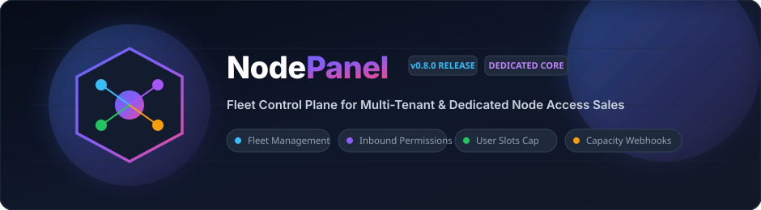
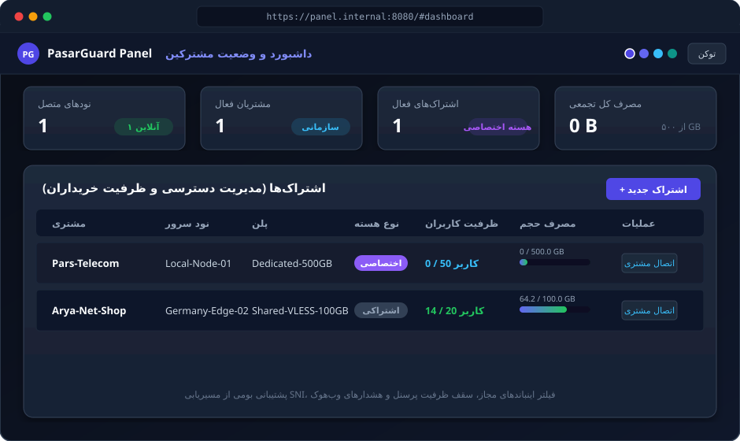
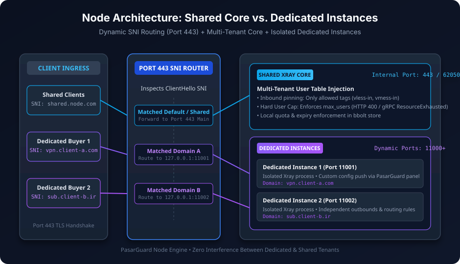

<div align="center">



# NodePanel — Control Plane for Selling Node Access

[](https://github.com/l8PYGIT/NodePanel/releases)
[](https://go.dev/)
[](LICENSE)
[](https://github.com/l8PYGIT/NodePanel)
[](docs/images/architecture.svg)
[](http://localhost:8080/docs)

<p align="center">
  <b>پنل کنترل مرکزی و متمرکز برای مدیریت ناوگان نودها، فروش سهمیه‌ای و هسته اختصاصی</b><br/>
  <i>ایزولاسیون کامل چند-مستأجری • مسیریابی پویا SNI روی پورت 443 • هشدارهای خودکار وب‌هوک ظرفیت</i>
</p>

[گزارش باگ](https://github.com/l8PYGIT/NodePanel/issues) · [مستندات کامل ویکی](docs/wiki/Home.md) · [مخزن عامل نود (NodeAgent)](https://github.com/l8PYGIT/NodeAgent)

</div>

---

## 🖥️ نمای پیش‌نمایش پنل وب (Web Dashboard Preview)



---

## 🏗️ معماری سیستم و تفکیک هسته‌ها (System Architecture)

سیستم از دو مدل هسته برای پاسخ‌گویی به نیازهای مختلف خریداران پشتیبانی می‌کند:
1. **هسته اشتراکی (Shared Multi-Tenant):** بهینه برای مصرف کم رم و ترافیک اشتراکی با جداسازی شناسه کاربران.
2. **هسته اختصاصی (Dedicated Core):** اجرای پروسس مستقل Xray روی پورت‌های پویا (`11000+`) با امکان تزریق کانفیگ و هدایت ترافیک دامنه‌های اختصاصی از طریق مسیریاب SNI روی پورت 443.



---

## 🛡️ ماتریس دسترسی و کنترل ظرفیت خریداران (Buyer Permissions & Governance)


---

## 🎯 مرز مسئولیت و فلسفه طراحی
* **صفر بودن منطق مالی:** پنل درگیر کیف‌پول، پرداخت بانکی و تتر نمی‌شود. تمام منطق مالی درون ربات فروش است.
* **تمرکز بر زیرساخت:** پنل وظیفه مدیریت بایت‌ها، زمان انقضا، اسلات‌های مجاز کاربران، سلامت نودها و ارسال وب‌هوک‌های تله‌متری را بر عهده دارد.

---

## ✨ ویژگی‌های برجسته
- **هسته اختصاصی در برابر اشتراکی (`core_type`):**
  - **Shared:** ادغام امن کاربران چند خریدار روی یک هسته سبک.
  - **Dedicated:** پروسس Xray اختصاصی با پورت‌های داخلی (`11000+`) و دامنه‌های اختصاصی خریدار با مسیریابی خودکار SNI روی پورت ۴۴۳.
- **فیلتر اینباندهای مجاز (`allowed_inbounds`):** محدودسازی خریدار فقط به پروتکل‌های تعیین‌شده (مانند `vless-in` یا `reality-in`).
- **کنترل سقف کاربران (`max_users`):** ممانعت سخت‌افزاری از افزودن کاربر فراتر از سقف خریداری‌شده با خطای `HTTP 400 Bad Request` و gRPC `codes.ResourceExhausted`.
- **محدودیت IP و سرعت (QoS):** سقف IP همزمان (`max_ips`) و محدودیت سرعت بر حسب مگابیت (`speed_limit_mbps`).
- **هشدارهای پیشگیرانه وب‌هوک با امضای HMAC:**
  - `users.threshold`: هشدار ۸۰٪ و ۹۰٪ ظرفیت پرسنل.
  - `users.limit_reached`: هشدار ۱۰۰٪ پر شدن اسلات کاربران.
  - `usage.threshold`: هشدار ۸۰٪ و ۹۵٪ حجم.
  - `usage.over_quota`: اتمام حجم (۱۰۰٪).
- **صفحه عمومی خریدار (`/sub/{token}`):**
  - نوار پیشرفت دوگانه (Dual Meters): حجم گیگابایتی + اسلات کاربران.
  - نمایش مشخصات هسته اختصاصی/اشتراکی، دامنه‌ها و اینباندهای مجاز بدون نیاز به توکن ادمین.
- **مدیریت چند نود (Fleet Management):** با قابلیت پین خودکار گواهی سلف‌ساین (TOFU).
- **رابط وب مدرن SPA:** داشبورد، نودها، مشتری‌ها، پلن‌ها، اشتراک‌ها، وب‌هوک‌ها، کاملاً RTL و چندتمه.
- **مستندات استاندارد OpenAPI 3.0 و Swagger UI** روی `/openapi.yaml` و `/docs`.

---

## 🚀 راهنمای نصب و راه‌اندازی سریع

### نصب خودکار با اسکریپت (سیستم‌های مبتنی بر لینوکس / systemd)
```bash
# نصب خودکار باینری آماده + سرویس systemd:
sudo bash -c "$(curl -sL https://raw.githubusercontent.com/l8PYGIT/NodePanel/main/scripts/pg-panel.sh)" @ install --port 8080
```

### اجرای محلی جهت توسعه و تست
```bash
# تنظیم توکن ادمین (حداقل ۲۴ کاراکتر)
$env:PANEL_API_TOKEN = "pasarguard-secret-admin-token-2026"
$env:PANEL_HTTP_ADDR = ":8080"

# اجرا
go run ./cmd/panel
# یا اجرای باینری کامپایل‌شده:
./panel.exe
```

* پنل وب: **[http://localhost:8080/](http://localhost:8080/)**
* مستندات اینتراکتیو API: **[http://localhost:8080/docs](http://localhost:8080/docs)**

---

## ⚙️ متغیرهای محیطی (Environment Variables)

| متغیر | پیش‌فرض | الزامی | شرح |
|---|---|:---:|---|
| `PANEL_HTTP_ADDR` | `:8080` | خیر | آدرس و پورت وب‌سرور پنل |
| `PANEL_DB_PATH` | `panel.db` | خیر | مسیر فایل دیتابیس SQLite |
| `PANEL_API_TOKEN` | — | **بله** | توکن احراز هویت Bearer (حداقل ۲۴ کاراکتر) |
| `PANEL_COLLECT_INTERVAL` | `30s` | خیر | بازه زمانی تجمیع خودکار ترافیک از نودها |

---

## 📂 ساختار ماژولار پروژه
```
cmd/panel/            نقطه ورود و اجرای سرور
internal/store/       لایه پایگاه داده SQLite و اسکیماها
internal/nodeclient/  کلاینت ارتباط امن با نودها (Master Key + TOFU Pin)
internal/api/         اندپوینت‌های REST API + صفحه عمومی اشتراک + گردآورنده مصرف
internal/webhook/     سیستم ارسال وب‌هوک با امضای HMAC-SHA256
internal/web/         دارایی‌های فرانت‌اند وب SPA + مشخصات OpenAPI
```

---

<div align="center">
  <sub>طراحی شده برای ارائه بالاترین پایداری در فروش دسترسی نودها • انتشار تحت مجوز MIT</sub>
</div>
