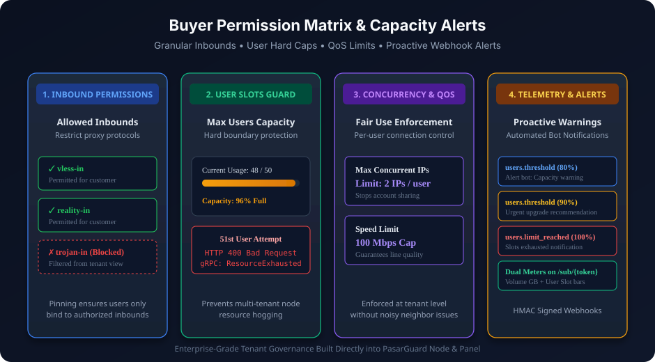

# NodePanel — control plane for selling node access

پنل اصلی (Control Plane) برای **فروش دسترسی نود با سهمیه‌ی حجم**: مدیریت **چند نود (fleet)**، مشتری/پلن/اشتراک/سهمیه، جمع‌آوری مصرف و expose برای بیلینگ بیرونی (ربات فروش)، با **API مستند (OpenAPI)** و **پنل وب ریسپانسیو**.

> Repo: `https://github.com/loopy-iri/NodePanel`  
> نودِ چند-مستأجری در ریپوی جدا: `https://github.com/loopy-iri/NodeAgent`  
> 📖 **راهنمای کامل (نصب، فروش، اتصال مشتری، API):** [`docs/wiki/`](docs/wiki/Home.md)

---

## معماری سیستم و تفکیک هسته‌ها (Architecture)


---

## ماتریس دسترسی‌های خریدار و کنترل ظرفیت (Buyer Permissions & Governance)



---

## مرز مسئولیت
پنل **منطق پول ندارد** (کیف‌پول/قیمت/پرداخت در ربات فروش است). فقط بایت/زمان/وضعیت و مجوزها را مدیریت کرده و مصرف/ظرفیت را از طریق API + webhook به ربات expose می‌کند.

## ویژگی‌های کلیدی
- **هسته اختصاصی در برابر هسته اشتراکی (`core_type`):**
  - **هسته اشتراکی (`shared`):** کاربران چندین خریدار روی یک هسته Xray سبک تجمیع و با emailهای مجزا تفکیک می‌شوند.
  - **هسته اختصاصی (`dedicated`):** خریدار یک پروسس Xray مستقل روی پورت‌های داخلی (`11000+`) دریافت می‌کند و می‌تواند کانفیگ کامل خود را از طریق پنل PasarGuard اعمال کند. ترافیک روی پورت 443 با **مسیریاب SNI** بر اساس دامنه‌های خریدار تفکیک و هدایت می‌شود.
- **تفکیک و فیلتر اینباندها (`allowed_inbounds`):** مشخص کردن دقیق پروتکل‌ها و اینباندهایی که خریدار مجاز به استفاده از آن‌هاست (مثلاً فقط `vless-in` یا `reality-in`). سایر اینباندها از دید خریدار مخفی و مسدود می‌شوند.
- **کنترل سقف کاربران (`max_users`):** اعمال محدودیت سخت‌افزاری بر تعداد کاربرانی که خریدار می‌تواند در پنل خود اضافه کند. در صورت تکمیل ظرفیت، درخواست رد می‌شود (`HTTP 400 Bad Request` و gRPC `ResourceExhausted`).
- **کنترل کیفیت سرویس (QoS):** محدودیت سرعت بر حسب مگابیت (`speed_limit_mbps`) و سقف IP همزمان برای هر کاربر (`max_ips`) جهت جلوگیری از اکانت‌فروشی غیرمجاز.
- **هشدارهای پیشگیرانه ظرفیت (Webhooks):**
  - وب‌هوک مصرف حجم: `usage.threshold` (در ۸۰٪ و ۹۵٪) و `usage.over_quota` (در ۱۰۰٪).
  - وب‌هوک ظرفیت کاربران: `users.threshold` (در ۸۰٪ و ۹۰٪) و `users.limit_reached` (در ۱۰۰٪) جهت پیشنهاد تمدید یا ارتقای پلن به خریدار.
- **صفحه عمومی خریدار (`/sub/{token}`):**
  - نوار وضعیت دوگانه (Dual Meters): نمایش درصد مصرف حجم گیگابایتی + ظرفیت اسلات کاربران.
  - نشان نوع هسته (`هسته اختصاصی` یا `هسته اشتراکی`) و لیست دامنه‌های متصل.
- **مدیریت چند نود با پین گواهی TLS / TOFU خودکار.**
- **پنل وب کامل ادمین (SPA):** داشبورد، مدیریت نودها، مشتری‌ها، پلن‌ها، اشتراک‌ها، وب‌هوک‌ها، RTL، چندتم (light/dark/midnight/emerald).
- **OpenAPI 3.0 و Swagger UI** روی `/openapi.yaml` و `/docs`.

## اجرا

```bash
# نصب کامل (دانلود باینری per-arch + systemd؛ بدون build روی سرور):
sudo bash -c "$(curl -sL https://raw.githubusercontent.com/loopy-iri/NodePanel/main/scripts/pg-panel.sh)" @ install

# یا از روی clone:
sudo bash scripts/pg-panel.sh install --port 8080
```

دستورهای CLI: `install, update [VER], uninstall, up, down, restart, status, logs, set-token [TOKEN], info, edit-env, completion`.

> نصب از **باینری از‌پیش‌ساخته** (GitHub Releases، web embed‌شده در باینری) و اجرا با **systemd** (سرویس `pg-panel`) — بدون Docker. برای ساخت باینری‌ها یک تگ `v*` push کن.

### اجرای محلی (توسعه)
```bash
$env:PANEL_API_TOKEN="local-dev-token-please-change-me"; go run ./cmd/panel
# UI:   http://localhost:8080/
# Docs: http://localhost:8080/docs
```

## متغیرهای محیطی

| متغیر | پیش‌فرض | شرح |
|---|---|---|
| `PANEL_HTTP_ADDR` | `:8080` | آدرس گوش‌دادن |
| `PANEL_DB_PATH` | `panel.db` | مسیر SQLite |
| `PANEL_API_TOKEN` | **الزامی** | توکن Bearer برای `/api/*` — حداقل ۲۴ کاراکتر |
| `PANEL_COLLECT_INTERVAL` | `30s` | بازه‌ی usage collector |

`PANEL_API_TOKEN` پیش‌فرض ندارد و پنل بدون آن بالا نمی‌آید:
```bash
openssl rand -hex 32
```

## ساختار
```
cmd/panel/            entrypoint
internal/store/       SQLite + schema + migrations
internal/nodeclient/  client نود (master key + pin/TOFU)
internal/api/         REST API + collector + subpage + lifecycle
internal/webhook/     dispatcher امضاشده HMAC-SHA256
internal/web/         پنل وب embed‌شده + openapi.yaml + Swagger UI
```
