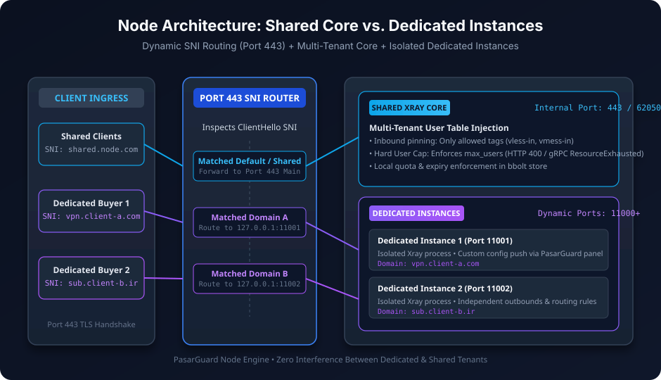
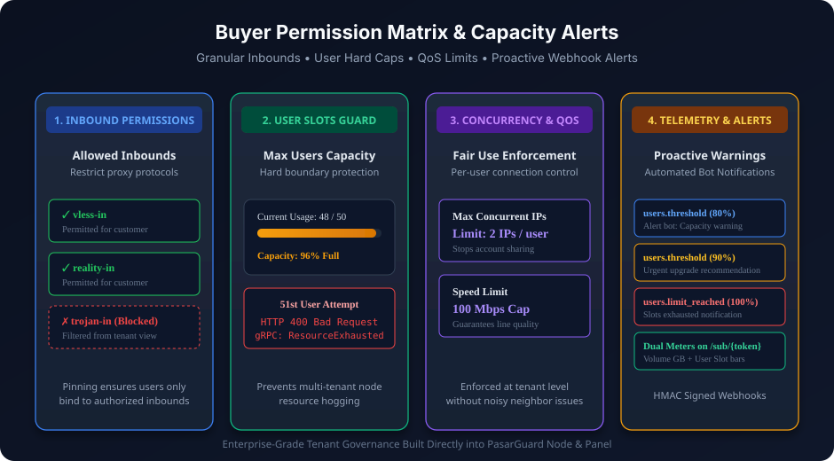

<div dir="rtl">

[🇬🇧 English](04-Add-Node-And-Sell-EN) · **🇮🇷 فارسی**

# ۳) افزودن نود و فروش (اپراتور)

می‌توانی از **رابط وب پنل** (`http://PANEL_IP:8080/`) یا مستقیم از **API** (`/docs`) استفاده کنی. در ادامه هر دو نشان داده شده است.

---

## معماری و تفکیک دسترسی‌های خریدار





---

## گام ۱: افزودن نود به پنل
چیزهایی که از خروجی نصب نود لازم داری: آدرس `https://NODE_IP:8090`، **master key**، و **گواهی** نود.

از رابط وب: بخش Nodes → Add → پر کردن نام/آدرس/master key و چسباندن گواهی.

> پس از ثبت، روی نود دکمه‌ی **«جزئیات»** را بزن تا همه‌ی اطلاعات اتصال نود را یک‌جا با دکمه‌ی کپی ببینی: **IP/هاست، پورت سرویس (HTTP)، آدرس و پورت gRPC، پروتکل، و گواهی**. اگر نود را روی پورت gRPC غیرپیش‌فرض نصب کرده‌ای، موقع ثبت فیلد **«پورت gRPC»** را تنظیم کن (پیش‌فرض `62050`).

از API:
```bash
curl -X POST http://PANEL_IP:8080/api/v1/nodes \
  -H "Authorization: Bearer $PANEL_TOKEN" -H "Content-Type: application/json" \
  -d '{
    "name": "node-de-1",
    "address": "https://NODE_IP:8090",
    "master_key": "<MASTER_KEY>",
    "cert_pem": "-----BEGIN CERTIFICATE-----\n...\n-----END CERTIFICATE-----"
  }'
```
- `cert_pem` را برای **pin** بده. اگر خالی بگذاری، پنل بار اول گواهی را خودکار می‌گیرد (TOFU).
- سلامت نود: `GET /api/v1/nodes/{id}/health`.

## گام ۲: ساخت پلن با مجوزها و نوع هسته
در این مرحله مشخص می‌کنی خریدار چه نوع دسترسی و امکاناتی خواهد داشت:
```bash
curl -X POST http://PANEL_IP:8080/api/v1/plans \
  -H "Authorization: Bearer $PANEL_TOKEN" -H "Content-Type: application/json" \
  -d '{
    "name": "Dedicated-VIP-500GB",
    "quota_bytes": 536870912000,
    "duration_days": 30,
    "max_users": 50,
    "core_type": "dedicated",
    "allowed_inbounds": ["vless-in", "reality-in"],
    "max_ips": 2,
    "speed_limit_mbps": 100
  }'
```
- **`core_type`:**
  - `shared`: هسته اشتراکی استاندارد (کاربران چند خریدار روی یک هسته سبک Xray).
  - `dedicated`: هسته اختصاصی؛ پروسس Xray مستقل برای خریدار روی پورت‌های پویا (`11000+`).
- **`allowed_inbounds`:** آرایه‌ای از تگ‌های اینباندهای مجاز (مانند `["vless-in"]`). خریدار فقط این اینباندها را می‌بیند. خالی = همه اینباندها.
- **`max_users`:** سقف مجاز کاربر برای این پلن (۰ = نامحدود). نود در صورت پر شدن ظرفیت کاربر، درخواست‌های جدید را با خطای ۴۰۰ یا `ResourceExhausted` رد می‌کند.
- **`max_ips`:** حداکثر IP همزمان برای هر کاربر (۰ = نامحدود).
- **`speed_limit_mbps`:** سقف سرعت به مگابیت (۰ = نامحدود).

## گام ۳: ساخت مشتری
```bash
curl -X POST http://PANEL_IP:8080/api/v1/customers \
  -H "Authorization: Bearer $PANEL_TOKEN" -H "Content-Type: application/json" \
  -d '{"name":"Ali Shop","external_ref":"bot-user-12345"}'
```
`external_ref` شناسه‌ی همان مشتری در ربات فروش است (اختیاری ولی مفید).

## گام ۴: ساخت اشتراک و اختصاص دامنه‌های اختصاصی
```bash
curl -X POST http://PANEL_IP:8080/api/v1/customers/<CUSTOMER_ID>/subscriptions \
  -H "Authorization: Bearer $PANEL_TOKEN" -H "Content-Type: application/json" \
  -d '{
    "plan_id": "<PLAN_ID>",
    "node_id": "<NODE_ID>",
    "domains": ["vpn.alishop.com"],
    "allowed_inbounds": ["vless-in"],
    "max_users": 50
  }'
```
پاسخ — **`api_key` فقط همین یک‌بار نمایش داده می‌شود**:
```json
{
  "subscription": { 
    "id": "...", 
    "status": "active", 
    "core_type": "dedicated",
    "domains": ["vpn.alishop.com"],
    "quota_bytes": 536870912000, 
    "max_users": 50
  },
  "api_key": "<CUSTOMER_KEY>",
  "node_address": "NODE_IP:62050",
  "sub_token": "20f575363c7f4e0b888f8e029ee77425"
}
```
- **`domains`:** در صورت اختصاص هسته اختصاصی، این دامنه‌ها در مسیریاب SNI روی پورت 443 ثبت می‌شوند تا ترافیک کاربر به اینستنس خریدار هدایت شود.

## گام ۵: تحویل به مشتری
این سه چیز را به مشتری بده:
1. **آدرس gRPC نود:** `NODE_IP:62050`
2. **گواهی نود** (همان PEM)
3. **کلید مشتری** (`api_key` بالا)

> 💡 **میان‌بر:** در رابط وب روی اشتراک دکمه‌ی **«اتصال مشتری»** را بزن. همه‌چیز — نوع هسته، دامنه‌ها، آدرس gRPC، گواهی، و **inboundهای فیلترشده‌ی مجاز** — یک‌جا با دکمه‌ی کپی آماده‌ی تحویل است:
> ```bash
> curl http://PANEL_IP:8080/api/v1/subscriptions/<SUB_ID>/connection \
>   -H "Authorization: Bearer $PANEL_TOKEN"
> ```

### 🔗 صفحه عمومی اشتراک مشتری (`/sub/<TOKEN>`)
هر اشتراک یک **لینک عمومی** دارد: `https://PANEL/sub/<TOKEN>`.
مشتری با باز کردن آن در مرورگر موارد زیر را به‌صورت زنده می‌بیند:
- **گیج‌های دوگانه پیشرفت (Dual Meters):** نوار درصد مصرف حجم گیگابایتی + نوار درصد ظرفیت کاربران پرسنل.
- نشان **هسته اختصاصی** یا **هسته اشتراکی**.
- دامنه‌های اختصاصی خریدار.
- کانفیگِ اینباندهای مجاز + آدرس gRPC + گواهی با دکمه‌های کپی مستقیم.

## گام ۶: هشدارهای خودکار وب‌هوک (Webhook Alerts)
پنل در مقاطع زیر به ربات فروش شما وب‌هوک ارسال می‌کند:
- **`users.threshold`:** هنگام رسیدن ظرفیت کاربران به ۸۰٪ و ۹۰٪ سقف مجاز.
- **`users.limit_reached`:** هنگام تکمیل ۱۰۰٪ ظرفیت اسلات‌های کاربران.
- **`usage.threshold`:** هنگام مصرف ۸۰٪ و ۹۵٪ حجم.
- **`usage.over_quota`:** اتمام حجم (۱۰۰٪).

</div>
